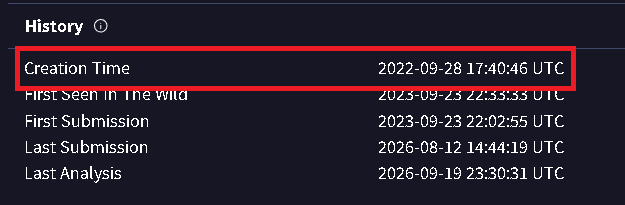
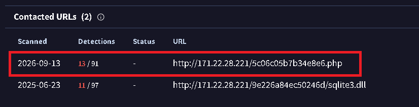
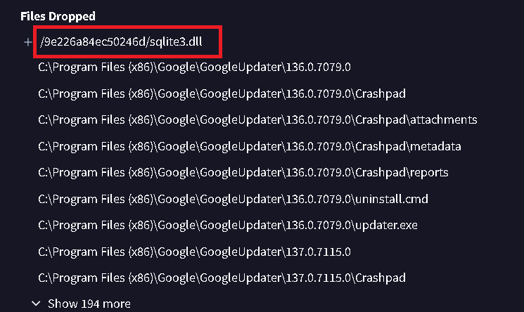
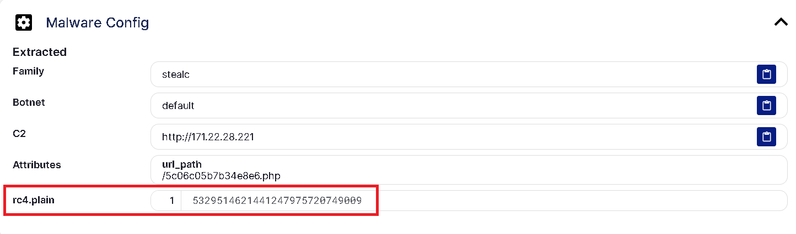
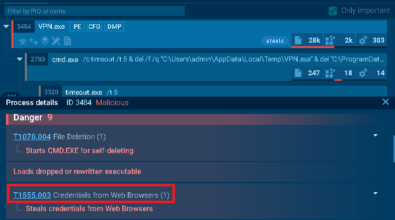
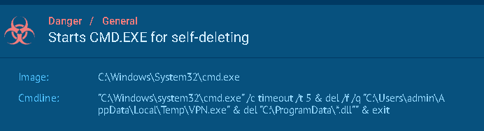
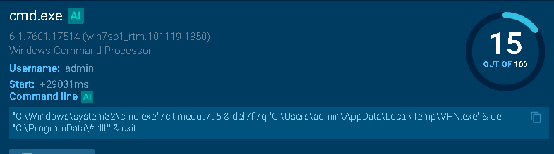

## Scenario Summary: 
The accountant at the company received an email titled "Urgent New Order" from a client late in the afternoon. When he attempted to access the attached invoice, he discovered it contained false order information. Subsequently, the SIEM solution generated an alert regarding downloading a potentially malicious file. Upon initial investigation, it was found that the PPT file might be responsible for this download. Could you please conduct a detailed examination of this file?

--- 

##Q1:
* **Question:** Determining the creation time of the malware can provide insights into its origin. What was the time of malware creation?
* **Answer:** `2022-09-28 17:40`

---

##Q2:
* **Question:** Identifying the command and control (C2) server that the malware communicates with can help trace back to the attacker. Which C2 server does the malware in the PPT file communicate with?
* **Answer:** `http://171.22.28.221/5c06c05b7b34e8e6.php`
* **Explanation:** Typically, the attackers used a `.php` server to carry out a C2 attack. The other URL corresponds to file that the attacker uploaded into the victim system.

---

##Q3:
* **Question:** Identifying the initial actions of the malware post-infection can provide insights into its primary objectives. What is the first library that the malware requests post-infection? 
* **Answer:** `sqlite3.dll` 
* **Explanation:** As i mentioned, the attacker uploaded the sqlite3.dll into the victim system through the C2 Server. 

---

##Q4:
* **Question:** By examining the provided Recorded Future Triage report, what RC4 key is used by the malware to decrypt its base64-encoded string?
* **Answer:** `5329514621441247975720749009` 

---

##Q5:
* **Question:** By examining the MITRE ATT&CK techniques displayed in the Any.run sandbox report, identify the main MITRE technique (not sub-techniques) the malware uses to steal the user’s password.
* **Answer:** `T1555`
  

---

##Q6:
* **Question:** By examining the child processes displayed in the Any.run sandbox report, which directory does the malware target for the deletion of all DLL files?
* **Answer:** `C:\ProgramData`
* **Explanation:** The command that cmd executed says `del C:\ProgramData\"*.dll"` which means to delete all `.dll` files found in the `ProgramData` folder located on the `C` drive.

---

##Q7:
* **Question:** Understanding the malware's behavior post-data exfiltration can give insights into its evasion techniques. By analyzing the child processes, after successfully exfiltrating the user's data, how many seconds does it take for the malware to self-delete?
* **Answer:** `5`
* **Explanation:** the command-line arguments of the cleanup process timeout /t 5, which introduces a 5-second pause prior to deleting the payload binary.

---

## Tools Used
* **Any.run**
* **Recorded Future Triage Sandbox**
* **Virus Total**
