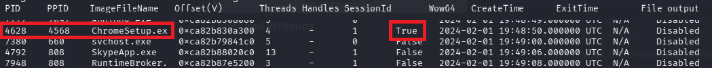
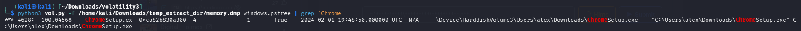
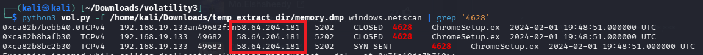
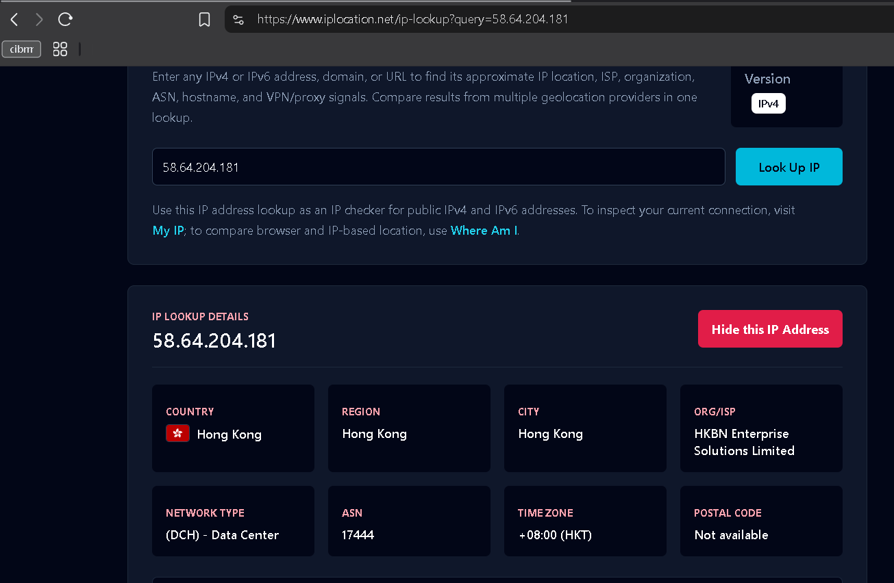
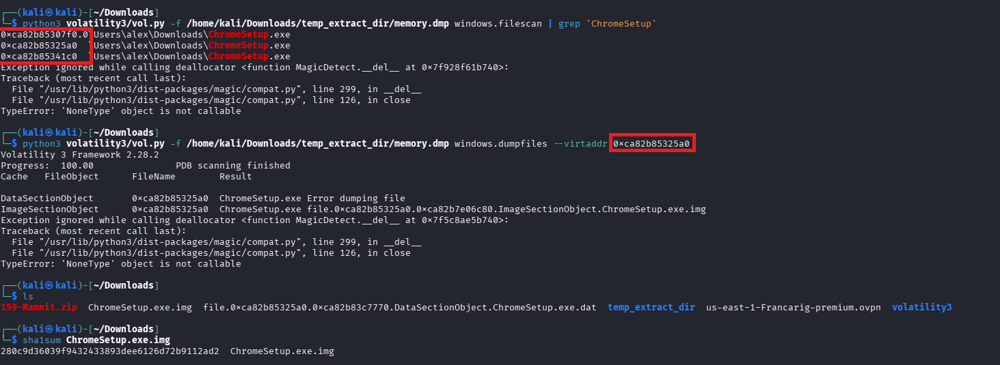
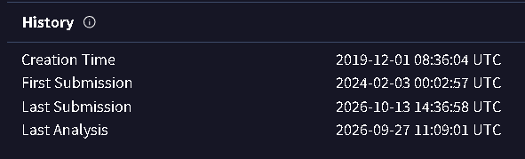
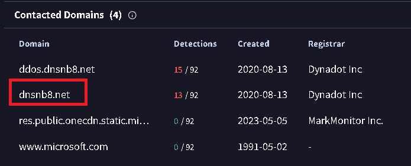

###Ramnit Lab
* **Lab link:** https://cyberdefenders.org/blueteam-ctf-challenges/ramnit/

## Scenario Summary:
* Our intrusion detection system has alerted us to suspicious behavior on a workstation, pointing to a likely malware intrusion. A memory dump of this system has been taken for analysis. Your task is to analyze this dump, trace the malware’s actions, and report key findings.
---
Q1:
* **Question:** What is the name of the process responsible for the suspicious activity?
* **Answer:** `ChromeSetup.exe`
* **Explanation:** `ChromeSetup.exe` is suspicious for 3 reasons. It was launched by `explorer.exe` (PID 4568), run in 32 Bits (WOW64 = TRUE) in a 64 bits enviroment common technique of malware and it did not launched any legitimate instalattion subprocess.

---

Q2:
* **Question:** What is the exact path of the executable for the malicious process?
* **Answer:** `C:\Users\alex\Downloads\ChromeSetup.exe`

---

Q3:
* **Question:** Identifying network connections is crucial for understanding the malware's communication strategy. What IP address did the malware attempt to connect to?
* **Answer:** `58[.]64[.]204[.]181` (Its defanged the IP address, the answer is not with [])
* **Explanation:** Identified using `windows.netscan`, which listed a TCP connections to `58[.]64[.]204[.]181` IP.

---

Q4:
* **Question:** To determine the specific geographical origin of the attack, Which city is associated with the IP address the malware communicated with?
* **Answer:** `hong kong`

---

Q5:
* **Question:** Hashes serve as unique identifiers for files, assisting in the detection of similar threats across different machines. What is the SHA1 hash of the malware executable?
* **Answer:** `280c9d36039f9432433893dee6126d72b9112ad2`
* **Explanation:** I dumped the executable to get the hash. (I rename the file)

---

Q6:
* **Question:** Examining the malware's development timeline can provide insights into its deployment. What is the compilation timestamp for the malware?
* **Answer:** `2019-12-01 08:36`

---

Q7:
* **Question:** Identifying the domains associated with this malware is crucial for blocking future malicious communications and detecting any ongoing interactions with those domains within our network. Can you provide the domain connected to the malware?
* **Answer:** `dnsnb8[.]net`
* **Explanation:** Virus Total shows the contacted domains. 

---

## Tools Used
* **Volatility**
* **Virus Total**
* **www[.]iplocation[.]net**
