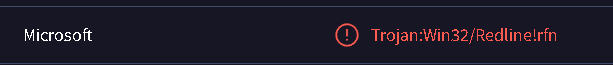
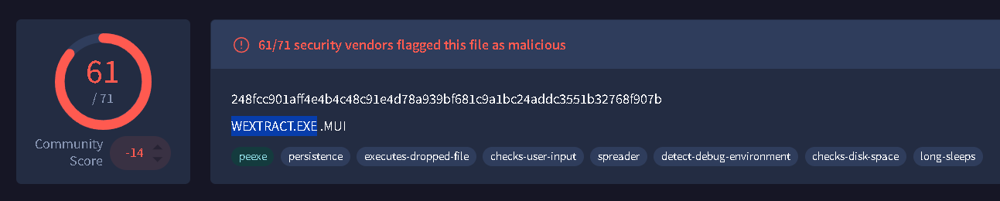
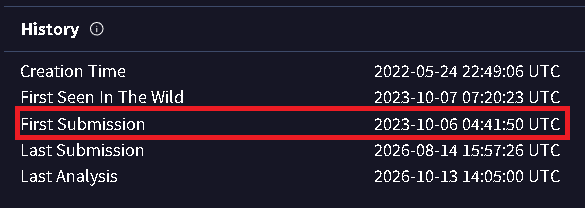
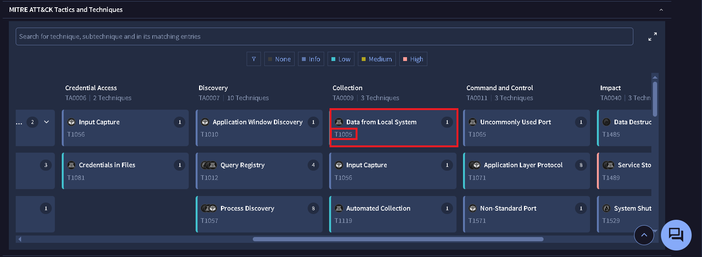
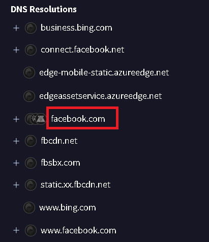
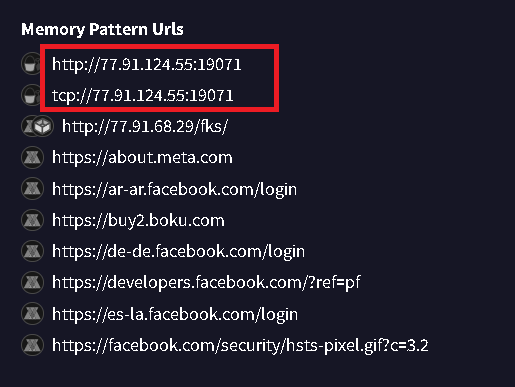
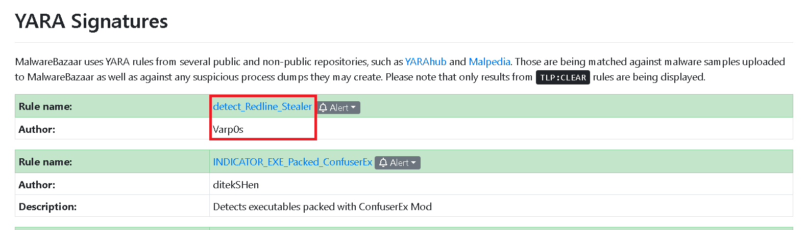
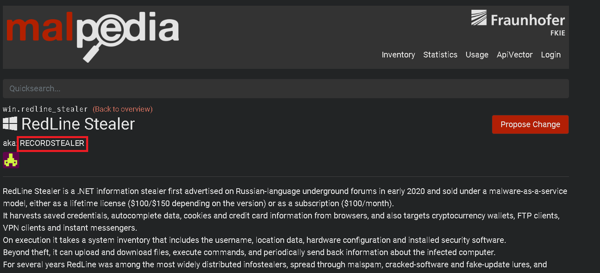
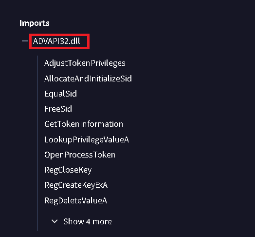

## Scenario Summary: 
* You are part of the Threat Intelligence team in the SOC (Security Operations Center). An executable file has been discovered on a colleague's computer, and it's suspected to be linked to a Command and Control (C2) server, indicating a potential malware infection.
Your task is to investigate this executable by analyzing its hash. The goal is to gather and analyze data beneficial to other SOC members, including the Incident Response team, to respond to this suspicious behavior efficiently.

---

## Q1:
* **Question:** Categorizing malware enables a quicker and clearer understanding of its unique behaviors and attack vectors. What category has Microsoft identified for that malware in VirusTotal?
* **Answer:** `Trojan`
* **Explanation:** Microsoft categorize the malware as a Trojan.

---

## Q2:
* **Question:** Clearly identifying the name of the malware file improves communication among the SOC team. What is the file name associated with this malware?
* **Answer:** `WEXTRACT`

---

## Q3:
* **Question:** Knowing the exact timestamp of when the malware was first observed can help prioritize response actions. Newly detected malware may require urgent containment and eradication compared to older, well-documented threats. What is the UTC timestamp of the malware's first submission to VirusTotal?
* **Answer:** `2023-10-06 04:41` 
* **Explanation:** Is located in the `DETAILS` section, and in `History`.

---

## Q4:
* **Question:** Understanding the techniques used by malware helps in strategic security planning. What is the MITRE ATT&CK technique ID for the malware collecting data from the local system prior to exfiltration?
* **Answer:** `T1005`
* **Explanation:** Checked VirusTotal's BEHAVIOR tab under MITRE ATT&CK Tactics & Techniques, identifying Data from Local System (T1005) under Collection.

---

## Q5:
* **Question:** Following execution, the malware performs a connectivity check by resolving a well-known social-media domain before contacting its C2. Which single domain does it resolve for this check?
* **Answer:** `facebook.com`
* **Explanation:** Found under VirusTotal's BEHAVIOR / RELATIONS section in the DNS resolutions log during execution.

---

## Q6:
* **Question:** Once the malicious IP addresses are identified, network security devices such as firewalls can be configured to block traffic to and from these addresses. Can you provide the IP address and destination port the malware communicates with?
* **Answer:** `77[.]91[.]124[.]55:19071`
* **Explanation:** Located the C2 IP address and destination port under the Memory Pattern URLs section in VirusTotal.

---

## Q7:
* **Question:** YARA rules are designed to identify specific malware patterns and behaviors. Using MalwareBazaar, what's the name of the YARA rule created by "Varp0s" that detects the identified malware?
* **Answer:** `detect_Redline_Stealer`
* **Explanation:** Searched the sample's SHA256 in MalwareBazaar and checked the YARA Rules section for author "Varp0s".

---

## Q8:
* **Question:** Understanding which malware families are targeting the organization helps in strategic security planning for the future and prioritizing resources based on the threat. Can you provide the different malware alias associated with the malicious IP address according to Malpedia?
* **Answer:** `RECORDSTEALER`
* **Explanation:** Searched the RedLine Stealer (win.redline_stealer) entry on Malpedia to locate its registered AKA alias.

---

## Q9:
* **Question:** By identifying the malware's imported DLLs, we can configure security tools to monitor for the loading or unusual usage of these specific DLLs. Can you provide the DLL utilized by the malware for privilege escalation?
* **Answer:** `ADVAPI32.dll`
* **Explanation:** Inspected DETAILS -> Imports in VirusTotal; ADVAPI32.dll handles security tokens and access control APIs.

---

## Tools Used
* **Virus Total**
* **Malpedia**
* **MalwareBazaar**
